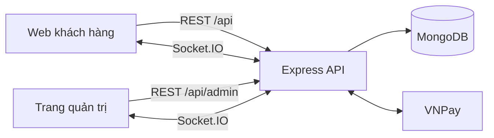

# ShopCar

[](https://github.com/PhuHuu16/ShopCar/actions/workflows/ci.yml)

Ứng dụng web cho showroom ô tô. Khách hàng xem, so sánh xe, tính trả góp, đặt mua và chat với showroom mà không cần tài khoản. Nhân viên quản lý xe, đơn hàng, khách hàng và tin nhắn qua trang quản trị. Dự án full-stack làm portfolio.

| Phần | Thư mục | Công nghệ |
|---|---|---|
| API | `server/` | Node.js, Express 5, MongoDB/Mongoose, Socket.IO, Zod, JWT |
| Web khách hàng | `client-customer/` | React 19, Vite, React Router 7, TanStack Query, Zustand, Tailwind CSS 4 |
| Trang quản trị | `client-admin/` | React 19, Vite, React Router 7, TanStack Query, Zustand, Tailwind CSS 4 |

## Tính năng

**Web khách hàng**

- Tìm xe có gợi ý khi đang gõ, gõ không dấu vẫn ra ("cx5" → Mazda CX-5)
- Danh sách xe với bộ lọc, sắp xếp, phân trang; trang chi tiết xe với thư viện ảnh và thông số
- Tính trả góp, so sánh tối đa 3 xe
- Giỏ hàng và đặt hàng không cần đăng nhập; xe được giữ 24 giờ, đặt cọc online qua VNPay (sandbox)
- Tồn kho và trạng thái đơn cập nhật tức thì
- Chat với showroom không cần đăng nhập; ngoài giờ có trợ lý tự động trả lời
- Tài khoản khách hàng: kích hoạt qua email, đặt lại mật khẩu, lịch sử đơn hàng
- Giao diện sáng / tối, dùng tốt trên điện thoại

**Trang quản trị**

- Tổng quan doanh thu, đơn hàng, xe bán chạy, xe sắp hết hàng
- Quản lý xe và ảnh; xe ngừng bán chỉ ẩn khỏi web, không bị xóa
- Xác nhận / hủy đơn, quản lý khách hàng, lời nhắn liên hệ và hộp thư chat
- Phân quyền hai vai trò: quản trị viên và nhân viên tư vấn
- Quản lý nhân viên: thêm, sửa, đặt lại mật khẩu, bật / tắt hoặc xóa tài khoản
- Nhật ký thao tác: ai đã làm gì, lúc nào

## Kiến trúc



Khi chạy production, một tiến trình Node phục vụ API, web khách hàng ở `/` và trang quản trị ở `/admin`.

## Chạy trên máy

Cần Node.js 20.12 trở lên. Không cần cài cơ sở dữ liệu: ở môi trường phát triển, API tự chạy MongoDB trên máy và thêm dữ liệu mẫu ở lần chạy đầu.

```bash
npm run setup   # cài đặt (lần đầu)
npm run dev     # API :3000, web http://localhost:5173, quản trị http://localhost:5174/admin
```

Cấu hình nằm trong `server/.env`, sao chép từ `server/.env.example`. Tài khoản quản trị đặt bằng `ADMIN_USERNAME` và `ADMIN_PASSWORD` trong file này. Danh sách API xem ở [server/README.md](server/README.md).

Các lệnh khác (chạy ở thư mục gốc):

```bash
npm run check   # lint + build, giống CI
npm run lint    # ESLint
npm run seed    # tạo lại dữ liệu mẫu
npm run build   # build hai web
npm start       # chạy production
```

## Triển khai lên Render

File `render.yaml` mô tả sẵn một dịch vụ web.

1. MongoDB Atlas: Network Access, thêm `0.0.0.0/0`.
2. Render: New > Blueprint, chọn repo này rồi nhập `MONGODB_URI`, `ADMIN_USERNAME`, `ADMIN_PASSWORD` (ít nhất 8 ký tự). `EMAIL_*` và `VNPAY_*` có thể để trống.

GitHub Actions chạy lint và build mỗi khi đẩy code (`.github/workflows/ci.yml`).
