# ShopCar

Ứng dụng web cho showroom ô tô: khách hàng xem và so sánh xe, tính trả góp, đặt mua qua giỏ hàng
(có thể đặt cọc online) và chat trực tiếp với showroom; nhân viên quản lý showroom qua trang quản trị.
Đây là dự án full-stack làm portfolio.

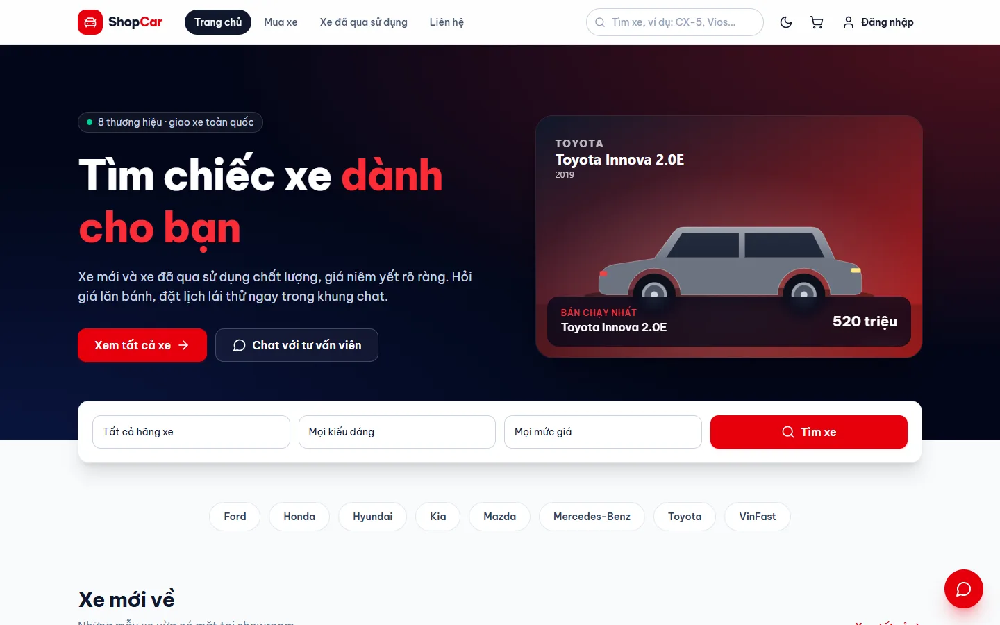

| Phần | Thư mục | Công nghệ |
|---|---|---|
| API | `server/` | Node.js, Express 5, MongoDB/Mongoose, Socket.IO, Zod, JWT, bcrypt, sharp |
| Web khách hàng | `client-customer/` | React 19, Vite, React Router 7, TanStack Query, Zustand, Tailwind CSS 4 |
| Trang quản trị | `client-admin/` | React 19, Vite, React Router 7, TanStack Query, Zustand, Tailwind CSS 4 |
| Kiểm thử | `.github/workflows/` | node:test + supertest, Vitest, ESLint, GitHub Actions |

## Ảnh chụp màn hình

| Trang chi tiết xe | Tính trả góp |
|---|---|
| 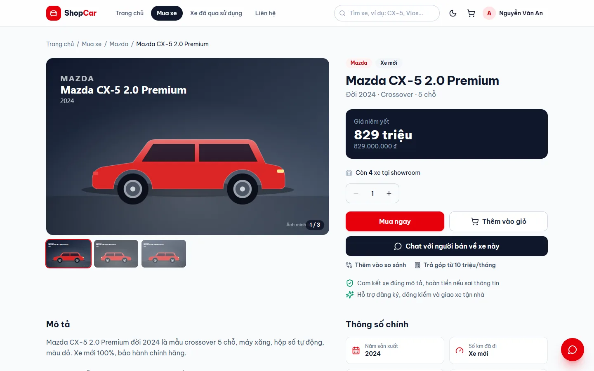 | 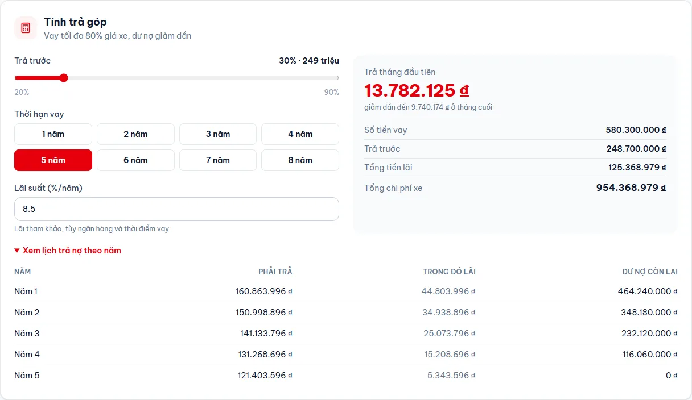 |
| **So sánh xe** | **Chat trực tiếp với showroom** |
| 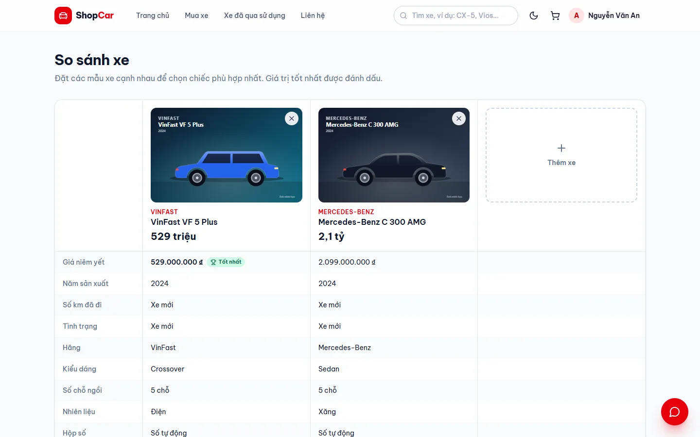 | 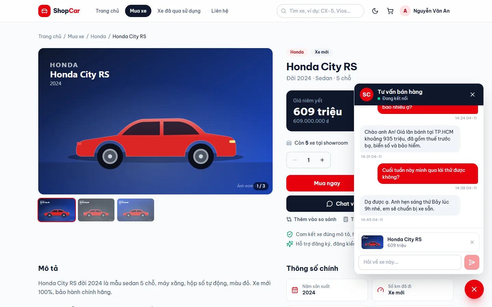 |
| **Danh sách xe với bộ lọc** | **Giỏ hàng với đặt cọc online** |
| 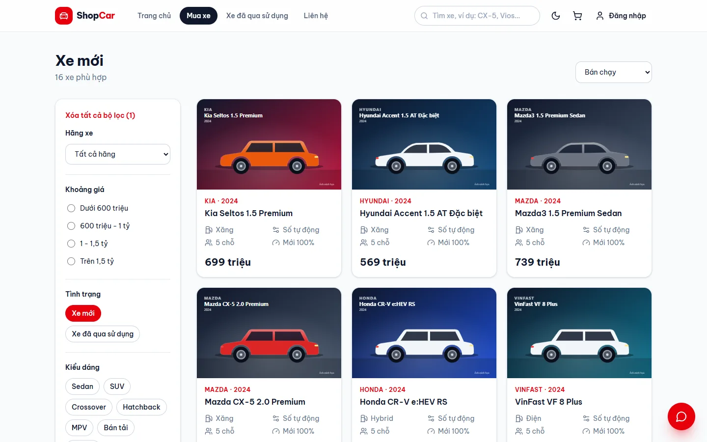 | 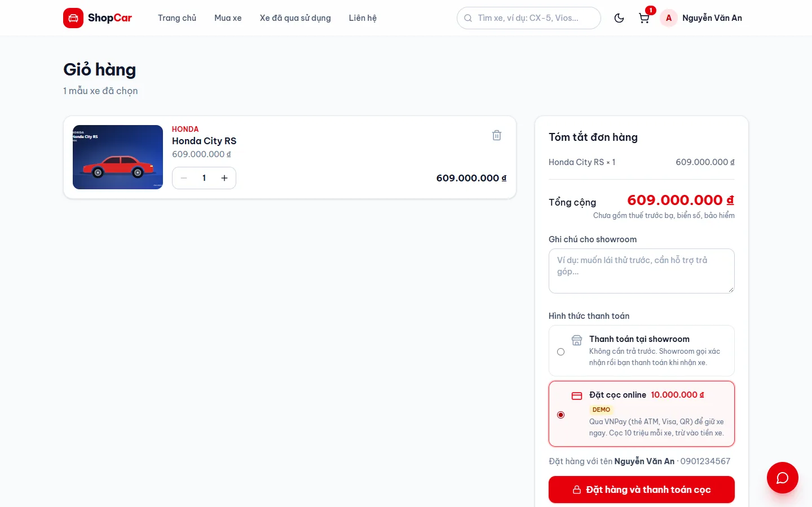 |

| Tổng quan (quản trị) | Chi tiết đơn hàng |
|---|---|
| 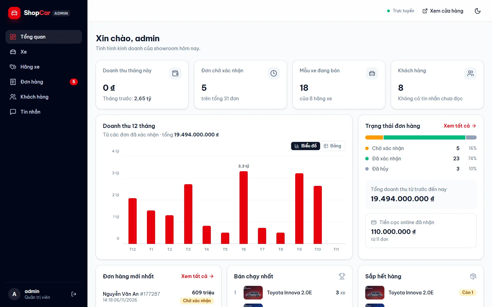 | 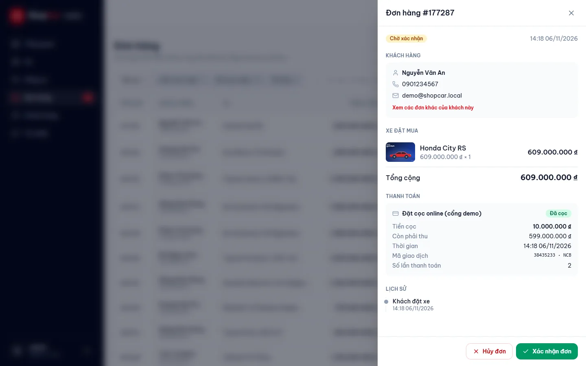 |
| **Hộp thư chat** | **Sửa xe và tải ảnh lên** |
| 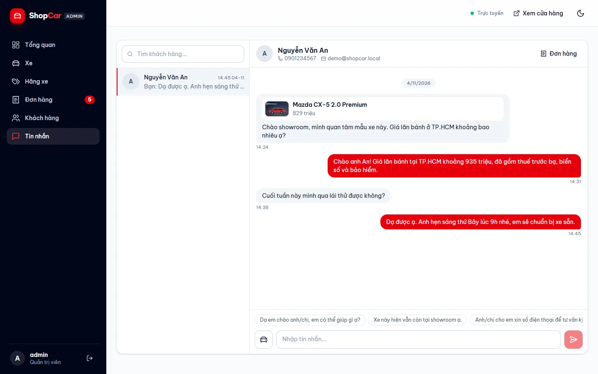 | 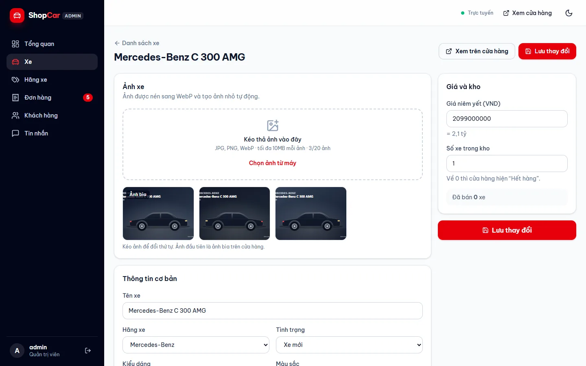 |
| **Giao diện tối** | **Giao diện tối (quản trị)** |
| 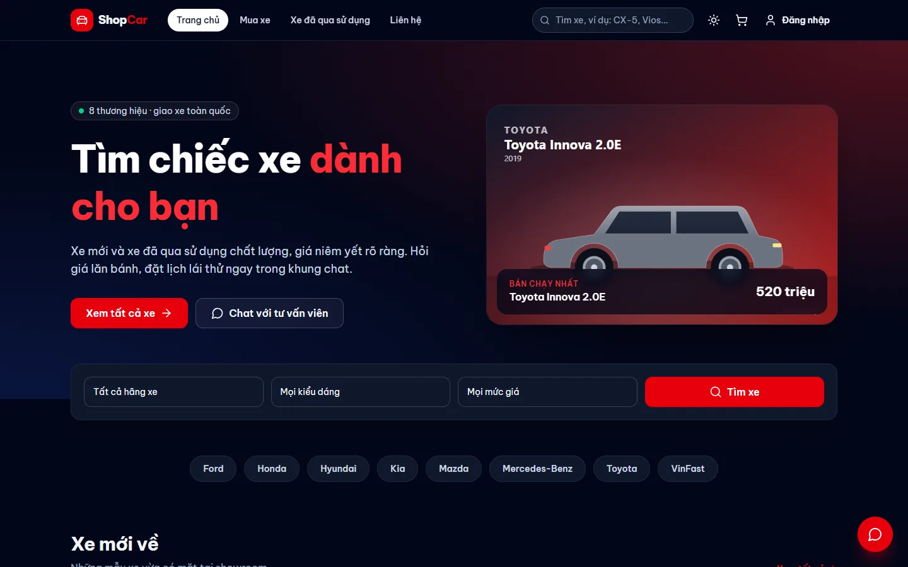 | 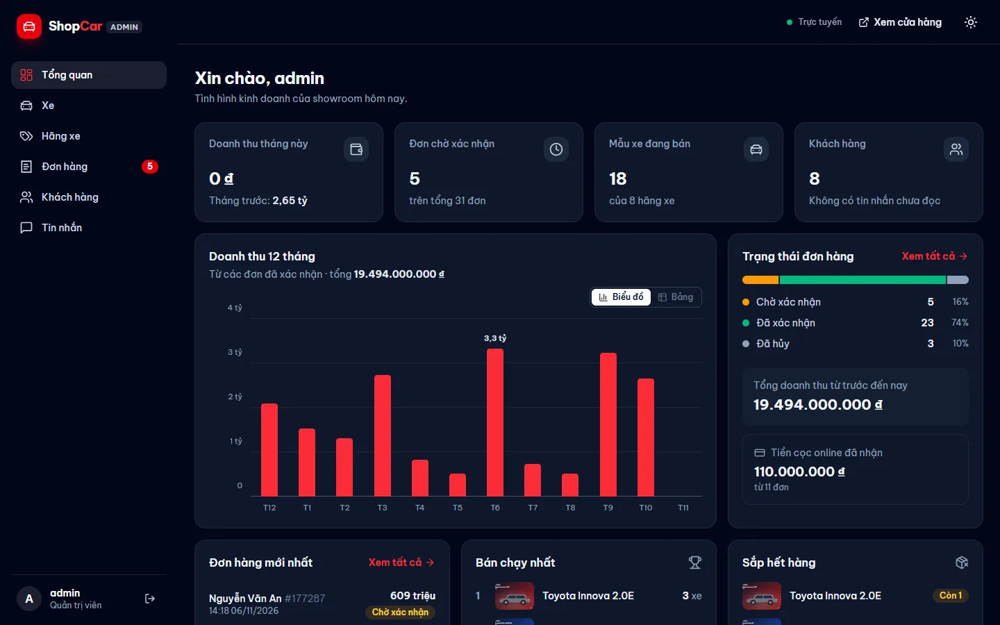 |

<p>
  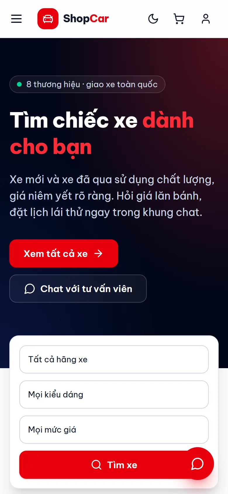
  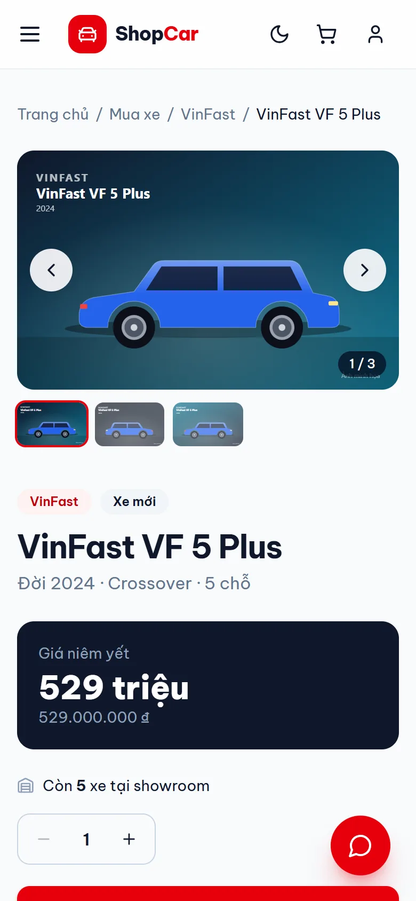
</p>

## Tính năng

Web khách hàng:

- Danh sách xe với bộ lọc (hãng, giá, kiểu dáng, nhiên liệu, hộp số, năm, xe mới/đã qua sử dụng), sắp xếp và phân trang
- Trang chi tiết xe với thư viện ảnh, thông số kỹ thuật và các xe liên quan
- Tính trả góp trên mọi trang xe (dư nợ giảm dần: trả trước, thời hạn vay, lãi suất, lịch trả nợ theo năm)
- So sánh tối đa 3 xe cạnh nhau, đánh dấu giá trị tốt nhất ở từng dòng
- Giỏ hàng lưu trong trình duyệt; server tính lại giá và kiểm tra tồn kho
- Tài khoản với link kích hoạt qua email, đặt lại mật khẩu và sửa thông tin cá nhân
- Chat trực tiếp với showroom, có thể đính kèm xe đang hỏi
- Lịch sử đơn hàng, hủy được đơn đang chờ xác nhận
- Đặt cọc online qua VNPay (sandbox) hoặc thanh toán tại showroom. Khi chưa có tài khoản VNPay, hệ thống dùng một trang thanh toán thử nghiệm có sẵn, nên toàn bộ luồng chạy được ngay
- Giao diện sáng và tối, dùng tốt trên điện thoại

Trang quản trị:

- Tổng quan: doanh thu 12 tháng gần nhất, tỷ lệ trạng thái đơn, tiền cọc, xe bán chạy, xe sắp hết hàng, đơn hàng mới nhất
- Xe: tìm kiếm và lọc, thêm/sửa xe, kéo thả ảnh để tải lên (tự chuyển sang WebP), sắp xếp lại ảnh, chọn ảnh bìa
- Đơn hàng: lọc theo trạng thái và tiền cọc, tìm theo tên/số điện thoại/mã đơn, xem thông tin giao dịch VNPay, xác nhận (trừ kho) hoặc hủy (trả lại kho)
- Khách hàng: số đơn và tổng tiền đã mua của từng khách, khóa/mở khóa, gửi lại email kích hoạt
- Hộp thư chat: tin nhắn thời gian thực, đếm tin chưa đọc, câu trả lời nhanh, đính kèm xe khi trả lời
- Thông báo tức thì khi có đơn mới, khách đặt cọc thành công hoặc có tin nhắn mới

## Kiến trúc

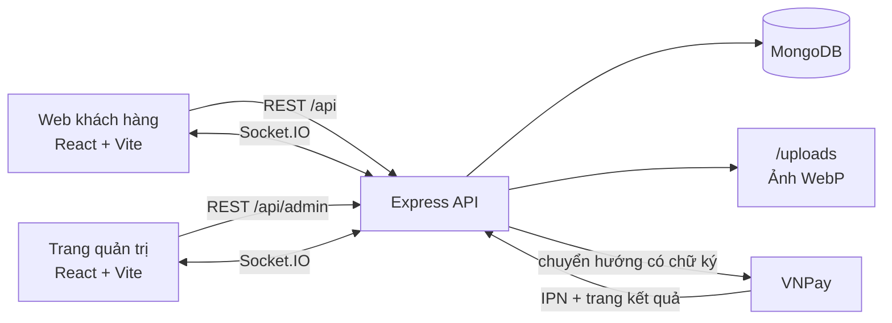

Khi chạy production, một tiến trình Node phục vụ cả API, web khách hàng ở `/` và trang quản trị ở `/admin`.

Một số điểm kỹ thuật đáng chú ý:

- **Server là nguồn dữ liệu chuẩn.** Giá và tổng tiền được tính lại từ cơ sở dữ liệu khi đặt hàng.
  Kho được trừ bằng lệnh cập nhật có điều kiện (`stock >= quantity`), nên hai quản trị viên xác nhận
  đơn cùng lúc cũng không thể bán vượt số xe còn lại (`server/src/services/orders.js`).
- **Ảnh.** Ảnh tải lên được thu nhỏ và chuyển sang WebP, kèm một ảnh nhỏ riêng cho danh sách, và được
  trình duyệt lưu cache lâu dài. Phiên bản gốc năm 2024 lưu ảnh dạng base64 ngay trong MongoDB.
- **Thời gian thực.** Kết nối Socket.IO được xác thực bằng cùng JWT với REST API và được chia phòng
  (mỗi cuộc trò chuyện một phòng, một phòng chung cho tất cả quản trị viên).
- **Thanh toán.** Yêu cầu gửi đi và kết quả VNPay trả về đều được ký bằng HMAC-SHA512 và so khớp bằng
  phép so sánh thời gian cố định. Trạng thái thanh toán chỉ được đổi khi đang ở `pending`, nên tải lại
  trang kết quả hay IPN đến muộn cũng không ghi nhận một khoản thanh toán hai lần
  (`server/src/services/payments.js`).
- **Kiểm tra dữ liệu.** Dùng Zod với thông báo lỗi tiếng Việt; lỗi hiện ngay cạnh ô nhập tương ứng trong form.
- **Không cần cài đặt gì để chạy thử.** Ở môi trường phát triển, API tự khởi động MongoDB
  (mongodb-memory-server) và thêm dữ liệu mẫu, chỉ cần `npm run dev`.

## Chạy trên máy

Cần Node.js 20.12 trở lên. Không cần cài cơ sở dữ liệu: ở môi trường phát triển, API tự khởi động
MongoDB và thêm dữ liệu mẫu ở lần chạy đầu tiên.

```bash
npm run setup   # cài đặt mọi thứ (lần đầu)
npm run dev     # API :3000, web http://localhost:5173, quản trị http://localhost:5174/admin
```

Tài khoản quản trị và mật khẩu của khách hàng mẫu được đặt trong `server/.env` (`ADMIN_USERNAME`, `ADMIN_PASSWORD`, `DEMO_PASSWORD`), không ghi trong mã nguồn. Mỗi lần khởi động, server cập nhật tài khoản quản trị theo file này.

Các lệnh khác (chạy ở thư mục gốc):

```bash
npm run check   # lint + toàn bộ test + build, giống hệt CI
npm test        # test API, rồi test hai web
npm run lint    # ESLint cho API và hai web
npm run seed    # tạo lại dữ liệu mẫu (tắt npm run dev trước)
npm run build   # build hai web (client-*/dist)
npm start       # server production: API + web ở / + quản trị ở /admin, chung một cổng
```

Cấu hình nằm trong `server/.env` (sao chép từ `server/.env.example`). Xem [server/README.md](server/README.md)
để biết danh sách API và cách kết nối tài khoản VNPay sandbox thật.

## Kiểm thử

| Bộ test | Công cụ | Nội dung |
|---|---|---|
| `server/test` (42) | node:test, supertest, MongoDB trong bộ nhớ | tài khoản và kích hoạt, phân quyền, bộ lọc xe, đơn hàng và tồn kho, quản lý xe và tải ảnh, chat qua Socket.IO, chữ ký VNPay và luồng đặt cọc |
| `client-customer/src/test` (18) | Vitest | tính trả góp, giỏ hàng và so sánh xe, định dạng giá, tên tiếng Việt cho mọi mã từ API |
| `client-admin/src/test` (11) | Vitest | định dạng số liệu biểu đồ và giá, hiển thị lỗi form, tên tiếng Việt cho mọi mã từ API |

GitHub Actions tự chạy lint, toàn bộ test và build hai web mỗi khi đẩy code hoặc tạo pull request
(`.github/workflows/ci.yml`).
